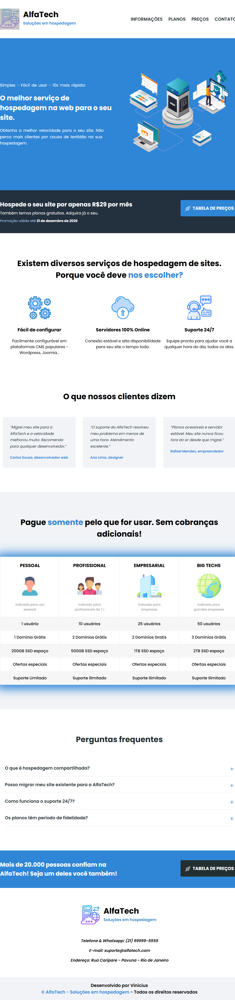
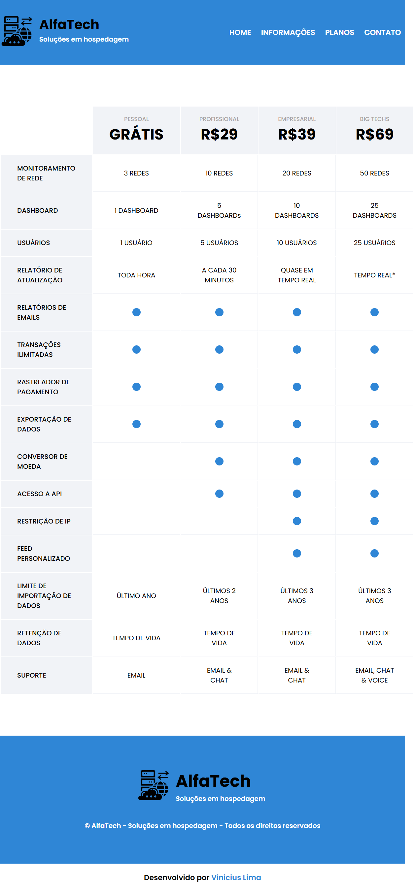

# 🌐 AlfaTech - Soluções em Hospedagem
Este projeto é uma página web institucional desenvolvida para promover os serviços de hospedagem da **AlfaTech**, com foco em simplicidade, clareza e uma apresentação visual moderna.

## 📸 Preview do Projeto
Página Home

---

## Página Preços

### Tecnologias Utilizadas

- HTML5
- CSS3
- Google Fonts
- Estruturação baseada em boas práticas de semântica e usabilidade

## 📄 Estrutura das Páginas

### Página Inicial

- A proposta da empresa.
- As vantagens e diferenciais da plataforma.
- Os planos disponíveis com detalhes.
- Seção FAQ para que o cliente não possua dúvidas na contratação
- Chamadas para ação (botões de aquisição e consulta de preços).
- Uma **segunda página interativa** dedicada aos planos e funcionalidades, com comparação detalhada entre as opções gratuitas e pagas.

### Página de Preços

- Interface interativa onde o usuário pode explorar cada plano com mais detalhes.
- Tabela comparativa de funcionalidades entre os diferentes pacotes (Grátis, R$29, R$39 e R$69).
- Ícones visuais indicando disponibilidade de recursos como: API, exportação de dados, dashboards, suporte, retenção de dados, entre outros.

## Funcionalidades em Destaque

- Design responsivo para dispositivos móveis, tablets e desktops.
- Estrutura clara e navegável com navegação simples no topo.
- Botões de ação estrategicamente posicionados para facilitar a conversão do visitante.
- Página de **preços interativa** que facilita a comparação dos planos por parte do usuário.

## 📬 Contato

**AlfaTech - Soluções em Hospedagem**  
📍 Rua Cariparé, 0 - Pavuna - Rio de Janeiro  
📞 Telefone & WhatsApp: (21) 99999-5555

📧 Email: suporte@alfatech.com
